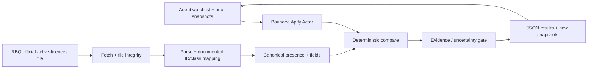
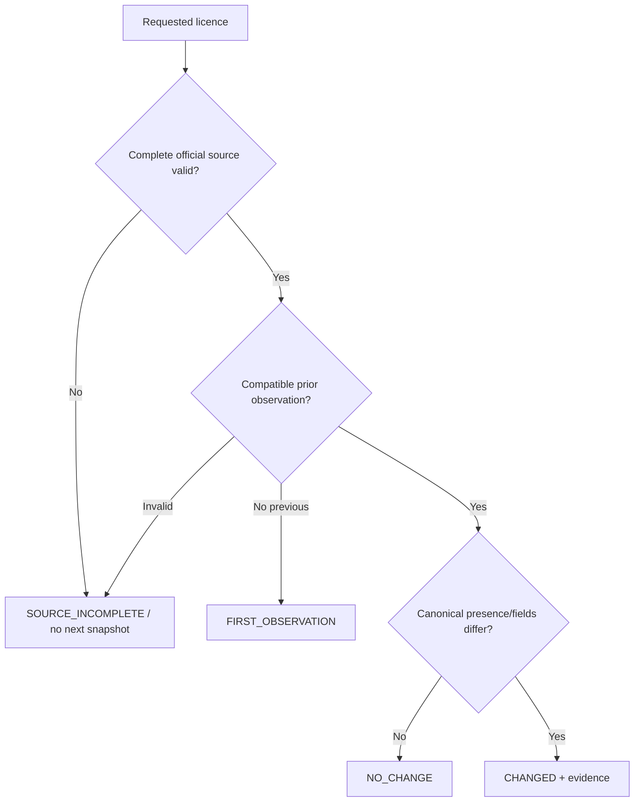

# Architecture (proposed, not implemented)

## Source boundary

The active-licences resource is updated daily and available on Données Québec in published formats (including JSON/CSV). A sample JSON has been described as large (~69 MB), **so parsing and Apify runtime sizing must be measured**. Do not assume a fast one-record fetch or a direct indexed API until tested. The initial implementation should scan/cache **one validated complete daily source**, not make 50 duplicate downloads.

The dataset has CC BY 4.0 attribution terms. Verify exact field names, licence-number formatting, resource hash/metadata, completeness indicators and update times against the actual current resource before implementing.

## Outcome semantics

`NOT_LISTED_IN_ACTIVE_DATASET` means only that the record was not found within a **validated complete official active-licences publication**. Do not infer suspension or revocation. All date fields must distinguish source publication time from time of Actor observation.

## Risk controls

- Max 50 explicitly supplied RBQ licence IDs; no bulk extraction/lead enrichment in MVP.
- Source fetch failures, truncated/malformed input, missing columns, duplicate licence IDs: fail closed.
- Preserve the last good caller-owned snapshot on incomplete sources.
- No unsupported guarantee that every change has been observed between daily snapshots.
- No LLM inference; no contact-data enrichment; no UI or custom MCP server.
- Field identity, class vocabulary and version changes require offline fixtures and schema conformance tests.
